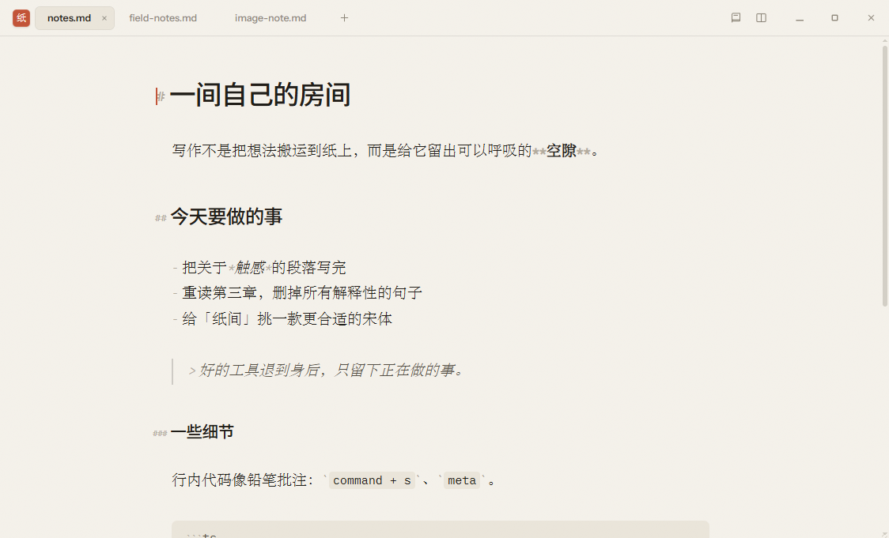
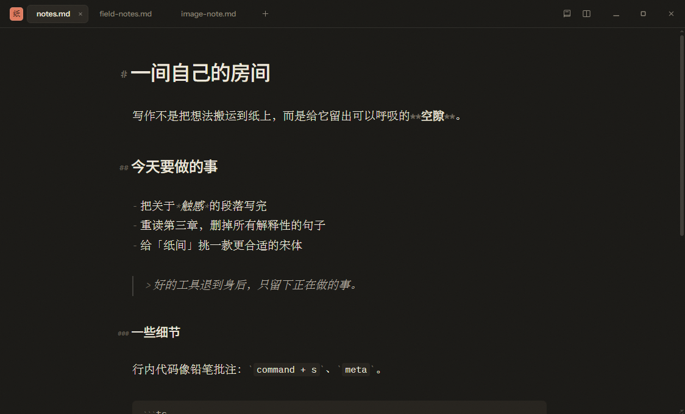
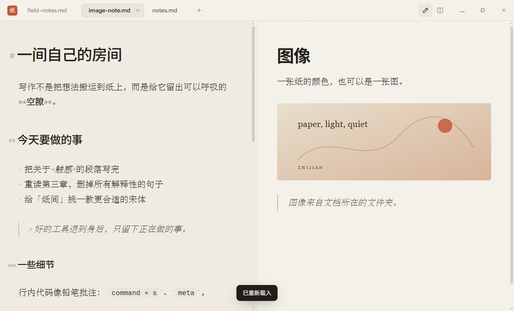
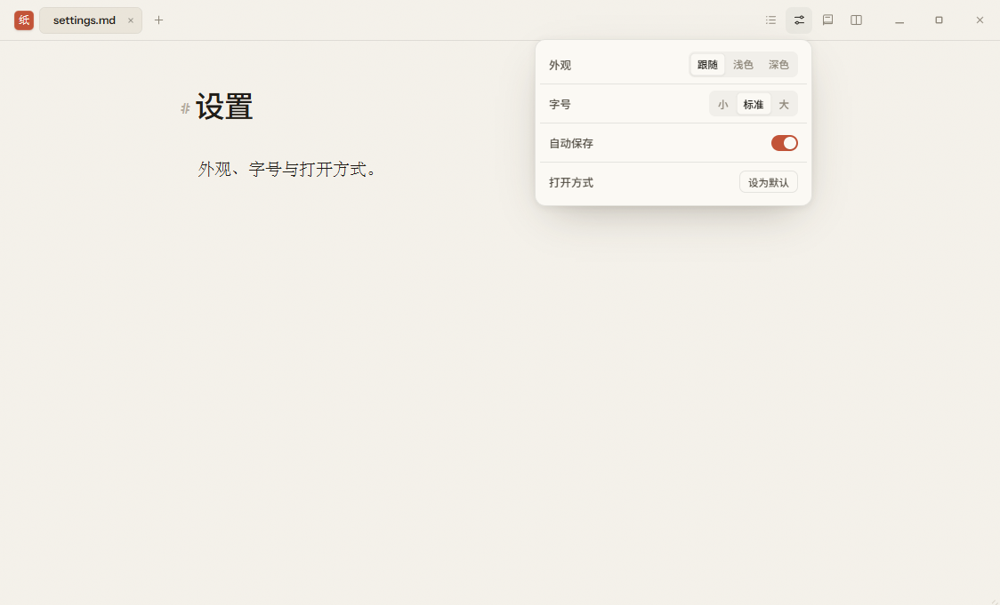
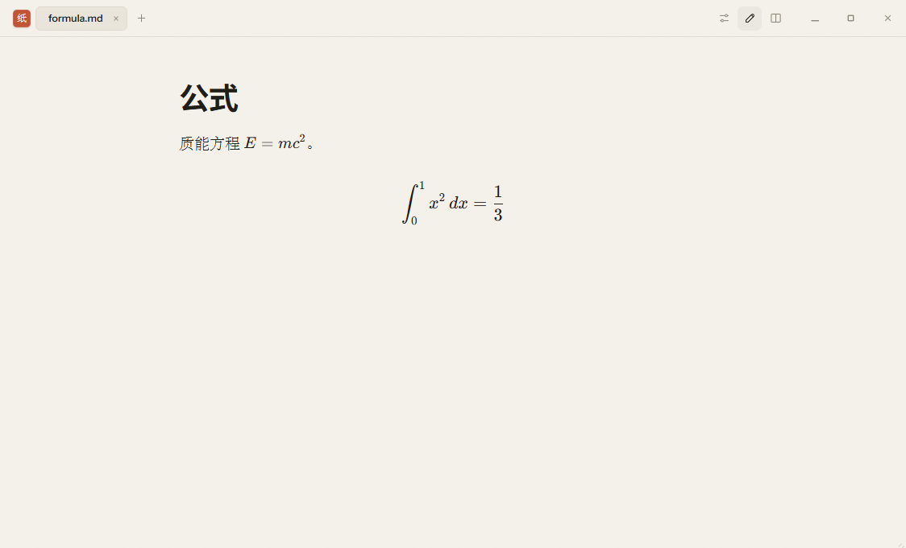
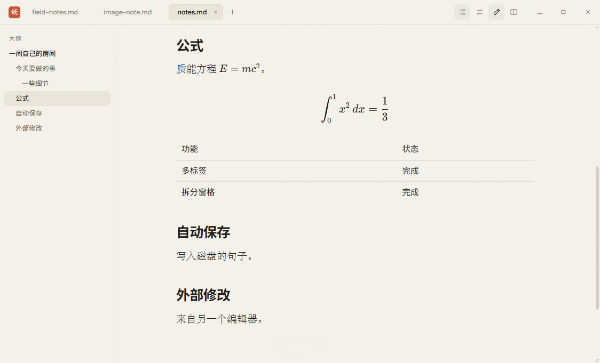

# 纸间

一个 Windows 上的 Markdown 编辑器。打开本地文件、轻量编辑、浏览器式多标签，以及可以拖动拆分的窗格。



## 功能

- 打开、编辑、另存 Markdown 文件；原生文件对话框。
- 多标签：拖动排序、中键关闭、右键菜单、未保存标记。
- 拆分窗格：把标签拖到窗格边缘，支持左侧、右侧、上方、下方与嵌套拆分。
- 分隔条拖拽调整比例，双击恢复 50/50；焦点窗格降低其余窗格底色。
- 每个窗格独立切换编辑 / 阅读视图；阅读视图支持表格、代码块、相对路径图片和 KaTeX 公式。
- 目录大纲：按标题层级列出当前窗格文档，点击跳到对应位置，编辑与阅读视图都适用。
- 可将纸间加入 `.md` / `.markdown` 的打开方式，并在系统确认后设为默认程序。
- 公式支持 `$...$`、`$$...$$`、`\(...\)`、`\[...\]`；编辑视图保留源文本，阅读视图负责排版。
- 750ms 防抖自动保存；外部修改冲突时询问“重新载入 / 仍然保存 / 取消”。
- CRLF 行尾保留；UTF-8 BOM 读取时清理；32MB 文件上限。
- 关闭窗口后恢复标签、分屏树、比例、阅读模式和未保存草稿。
- 跟随系统的浅色 / 深色主题；设置面板可覆盖外观、字号、自动保存和打开方式；无标语、无空状态说明、无次要标签。
- 完整键盘操作与窗口边缘缩放。

| 深色 | 分屏与阅读 |
| --- | --- |
|  |  |

## 安装版

双击 `release/Zhijian-Setup-0.3.2.exe`。默认安装到 `C:\Program Files\Zhijian`，也可以在安装向导里改到其他位置；为保证 .NET 运行时正常，安装路径需要只含英文字母、数字和空格。安装程序会创建开始菜单和桌面快捷方式，并带有卸载程序。安装需要管理员权限；设置和文档数据保存在当前用户目录，升级或卸载程序不会删除。

安装时默认勾选“将纸间加入 Markdown 文件的打开方式”。安装后打开设置 → 打开方式 → 设为默认，在系统对话框中选择纸间并勾选始终使用即可。Windows 10/11 会保留最终的默认程序确认，安装程序不会绕过这一步。

如果从包含中文的路径直接运行安装器没有反应，双击同目录的 `安装纸间.cmd`，它会先把安装器复制到公共目录再启动。

## 便携版

便携版在 `release/Zhijian-0.3.2-win64.zip`。

1. 解压到任意位置。
2. 双击 `启动纸间.cmd`。

首次启动时，启动器会把运行文件放到 `C:\Users\Public\Zhijian`，再从该路径打开。这是因为 Windows 上 pywebview 使用的 .NET 运行时无法解析含中文的安装路径；启动器把程序放到纯 ASCII 路径即可绕过。之后的启动会直接复用，不会反复复制。

如果程序已经位于纯英文路径（例如 `C:\Zhijian`），也可以直接双击 `Zhijian.exe`。

程序未做代码签名；Windows 首次运行可能显示“未知发布者”，选择“更多信息 → 仍要运行”即可。

系统要求：Windows 10/11，已安装 Microsoft Edge WebView2 Runtime（Windows 10/11 通常自带）。

## 从源码运行

```powershell
npm install
pip install -r requirements-dev.txt
npm run dev
```

`npm run dev` 会先构建前端，再启动原生窗口。前端使用 Vite 构建，但运行时不需要 Node 或开发服务器。

只用 Python 启动：

```powershell
npm run build
python -m app.main
```

## 构建便携版

```powershell
npm run package
```

输出：

- `release/Zhijian/`：PyInstaller 目录版。
- `release/Zhijian-0.3.2-win64.zip`：便携包，解压后运行 `启动纸间.cmd`。
- `release/Zhijian-Setup-0.3.2.exe`：Windows 安装程序。

打包需要 `pyinstaller` 与 `Pillow`，见 `requirements-dev.txt`。

## 快捷键

| 快捷键 | 操作 |
| --- | --- |
| `Ctrl N` | 新建文档 |
| `Ctrl O` | 打开文件 |
| `Ctrl Shift O` | 打开 / 关闭目录大纲 |
| `Ctrl S` | 保存 |
| `Ctrl Shift S` | 另存为 |
| `Ctrl W` | 关闭标签页 |
| `Ctrl Shift W` | 合并当前窗格 |
| `Ctrl E` | 切换编辑 / 阅读 |
| `Ctrl Tab` / `Ctrl Shift Tab` | 下 / 上一个标签 |
| `Ctrl 1…9` | 跳到第 n 个标签 |
| `Ctrl B` / `Ctrl I` | 粗体 / 斜体 |
| `Ctrl K` | 插入链接 |
| `Ctrl F` | 在编辑器中搜索 |
| `Enter`（列表中） | 延续列表 |
| `Esc` | 关闭菜单 / 弹窗或取消拖拽 |

标签支持方向键、`Home`、`End` 导航，`Delete` 关闭。窗口可拖动标题栏移动、双击标题栏最大化、拖拽边缘或右下角握柄缩放。

右上角的滑块图标打开设置：外观（跟随系统 / 浅色 / 深色）、字号（小 / 标准 / 大）、自动保存开关。设置保存在本机。



## 公式

公式在**阅读视图**中排版；编辑视图仍显示 Markdown 源文本，方便修改。行内公式用 `$...$` 或 `\(...\)`，独立公式用 `$$...$$` 或 `\[...\]`。



## 目录大纲

点右上角的大纲图标，或按 `Ctrl Shift O`。大纲跟随当前获得焦点的窗格；点击任意标题会跳到编辑器的对应行，或滚动阅读视图到对应标题。



## 设计

完整设计说明见 [DESIGN.md](DESIGN.md)。核心约束：

- 一个操作只出现一次；能用布局表达的地方不加提示文字。
- 状态是纯粹的文档表加递归分屏树，所有结构变更都是可测试的纯函数。
- 编辑器与渲染层分离；切换文档时复用编辑器控制器，保留撤销历史与滚动位置。
- 原生窗口只负责文件、窗口和 WebView；UI 不依赖具体窗口实现。
- 为自动化留稳定 `data-testid`，原生端到端测试直接连接真实 WebView2。

## 测试

```powershell
npm test        # Vitest + Python unittest
npm run test:ui # 原生 WebView2 端到端
npm run test:all
```

端到端测试会启动应用并连接 WebView2 远程调试端口，覆盖：标签排序、自动保存、外部冲突、相对图片、拖拽分屏、分隔条缩放、未保存弹窗、会话恢复。运行前请确保 47999 / 9333 端口未被占用。

## 结构

```text
src/
  core/        文档与分屏状态、路径、Markdown 渲染、会话
  editor/      CodeMirror 6 扩展、Markdown 行级样式、编辑命令
  ui/          标签、窗格布局、编辑器控制器、菜单、弹窗
  styles/      设计变量与各区域样式
app/
  main.py      pywebview 窗口、JS API、窗口尺寸与图标
  bridge.py    读取、原子保存、冲突、原生文件对话框
  server.py    仅监听 127.0.0.1 的静态资源与图片服务
tests/         Vitest 与 Python 单元测试
scripts/       构建、原生 E2E、打包
```

## 已知限制

- 仅支持 UTF-8 编码的文本文件；非 UTF-8 文件会给出错误提示。
- 便携版直接双击 `Zhijian.exe` 时需要纯英文路径；中文路径请使用 `启动纸间.cmd`。
- 没有实现单实例转发：再次从资源管理器打开另一个文件会启动第二个窗口。
- 阅读视图只渲染 Markdown；不执行文档中的原始 HTML。

## 第三方

Newsreader、Instrument Sans、IBM Plex Mono 通过 Fontsource 打包，均为 SIL Open Font License 1.1。CodeMirror 6 与 markdown-it 为 MIT；pywebview 为 BSD-3-Clause；Python 为 PSF License。
